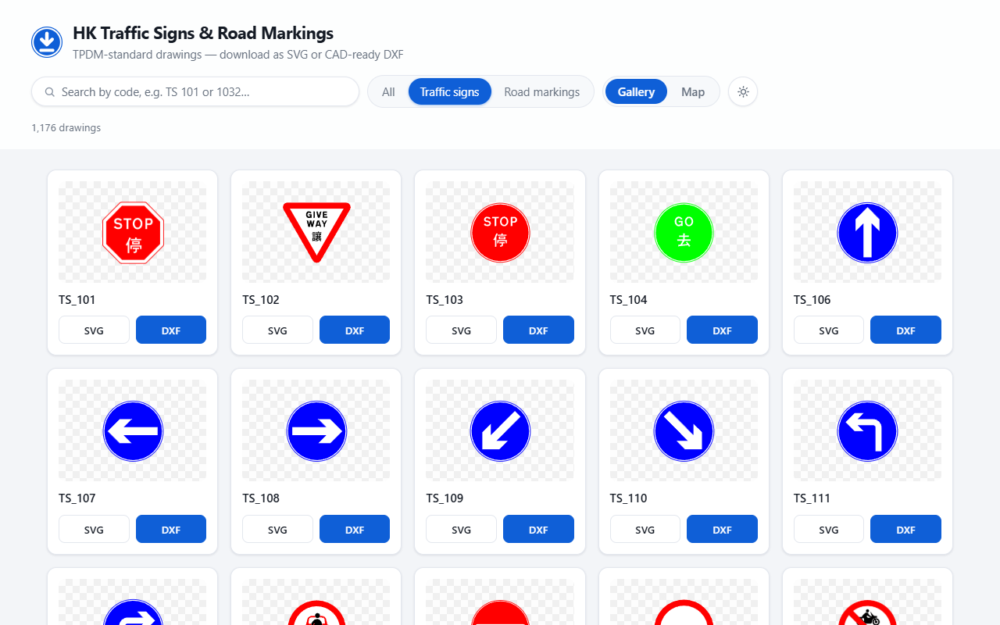
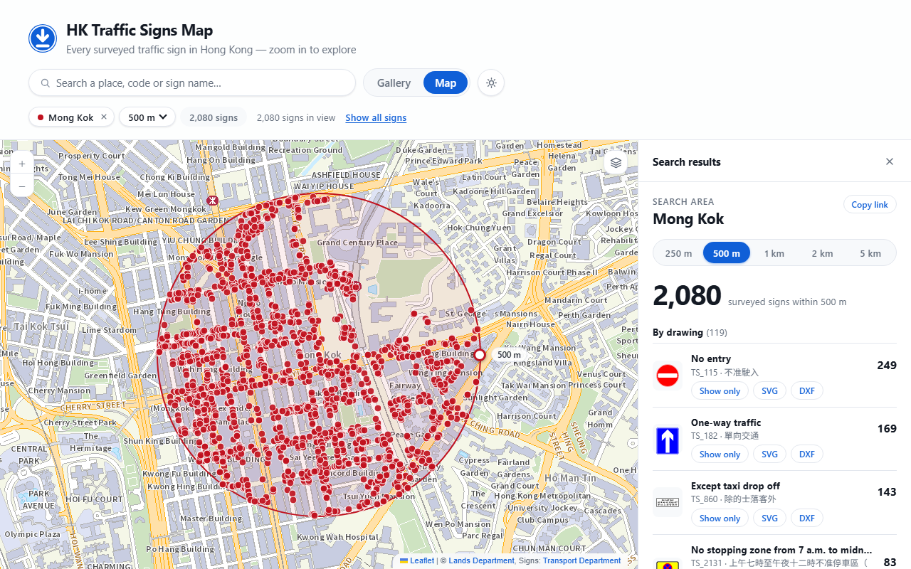
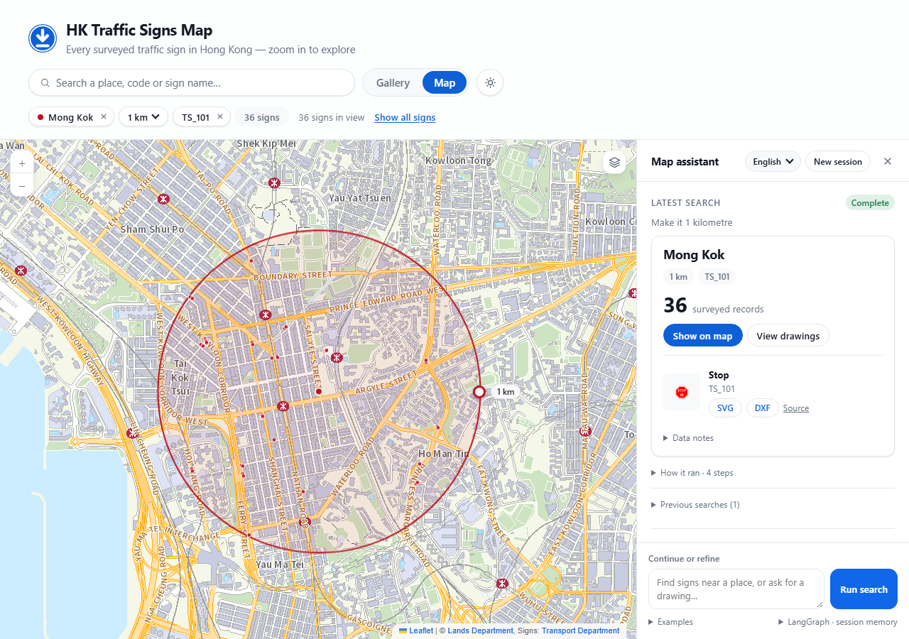

# Hong Kong Traffic Signs and Road Markings

Browse Hong Kong traffic signs and road markings, or explore surveyed traffic signs on a map. The public site is ready to use. A separate Docker version adds an assistant to the map.

## Use the public site

**[Open the gallery](https://lecberg.github.io/hk-tpdm-traffic-signs-markings/)** to browse 1,327 drawings. Search by code, filter signs and road markings, and download files as SVG or DXF. SVG is an image format. DXF is a drawing format used by design software.

[](https://lecberg.github.io/hk-tpdm-traffic-signs-markings/)

**[Open the map](https://lecberg.github.io/hk-tpdm-traffic-signs-markings/map.html)** to explore about 157,000 surveyed traffic sign locations. Zoom in to see sign faces. Select a sign to view its code and available downloads.

[](https://lecberg.github.io/hk-tpdm-traffic-signs-markings/map.html)

Use the map’s search box to find:

- **A drawing code**, such as `TS101` or `115`, to show only those signs.
- **A place**, such as “Mong Kok” or “Queen Mary Hospital”, to count every surveyed sign nearby. A panel lists the count, a breakdown by drawing, and SVG and DXF downloads.
- **A sign name**, such as “Stop” or “No entry”, for the 100 drawings with checked names.

The filters show as chips above the map. Change the radius from a chip or by dragging the circle’s edge, and remove a chip to drop that filter. Right-click the map to search around any point. Each search is saved in the page link, so you can share it or go back to the previous one.

The public site needs no installation or API key. It does not include the assistant.

## Run the Docker version with the assistant

The Docker version runs on your computer. It has the same Gallery and Map, and adds an assistant that understands requests in your own words. The assistant lives in the map’s results panel.



This example asks “Stop signs near Mong Kok within 500 metres”, then “Make it 1 kilometre”. It finds 36 surveyed Stop signs and shows them on the map.

Ask from the map’s search box (choose **Ask the assistant**) or from the box at the bottom of the panel. On the gallery, type a question and choose **Ask on the map**. When a place name matches several locations, pick one from the list or from the numbered pins on the map. A finished search is applied to the map, and follow-ups such as “Make it 1 kilometre” refine what the map shows, including any changes you made with the chips.

The assistant needs a configured model service. The model only interprets the request: counts come from the surveyed records, and drawings and downloads come from the catalog. Road-marking drawings are searchable by code, but surveyed road-marking locations are not available.

Assistant state is held in memory for the current session (one-hour inactivity expiry). Page refreshes keep it; restarting the backend or choosing **New session** clears it. The panel shows the steps a search took, not private model reasoning. Requests go to your configured provider; no additional tracing service is enabled.

### Run the prototype without Docker

Use Python 3.10+ (3.12 recommended), install the agent extras, and configure `.env` as below:

```sh
pip install -e ".[agent]"
python scripts/run_agent_prototype.py --port 8518
```

Open **http://localhost:8518/map.html?agent=1**. This development server binds only to localhost and leaves the public site's API disabled. Use Docker for the normal deployment.

### Start it

1. Install Docker Desktop or another Docker engine with Compose.
2. Copy `.env.example` to `.env`.
3. Run:

   ```sh
   docker compose up --build -d
   ```

4. Open **http://localhost:8517**.

Stop the site with `docker compose down`.

### Set up the assistant

In `.env`, choose one provider with `AI_PROVIDER`. Add that provider’s key and model. The available choices are `openai`, `deepseek`, `vercel`, and `custom`.

For example:

```text
AI_PROVIDER=deepseek
DEEPSEEK_API_KEY=your-key
```

For another service that accepts OpenAI-style chat requests, choose `custom`. Set `CUSTOM_API_BASE_URL`, `CUSTOM_MODEL`, and `CUSTOM_API_KEY`. The model must support tool calls so it can request sign and map data.

After changing `.env`, run:

```sh
docker compose up -d --force-recreate backend
```

Then refresh the page. Keep `.env` private; Git ignores it.

Assistant requests and their search results go to the chosen model service. Place searches outside the saved list go to the Lands Department’s location service, on both the public site and the Docker version. Map tiles require internet access.

## About the data

The drawings follow Hong Kong traffic sign and road marking standards. Map locations come from the Transport Department’s [Traffic Aids Drawings open data](https://data.gov.hk/en-data/dataset/hk-td-tis_16-traffic-aids-drawings-v2). Some surveyed signs may have no matching drawing available for download.

## Convert your own files without Docker

The project also includes a small SVG-to-DXF converter:

```sh
pip install -e .
svg2dxf sign.svg
```

The command writes `sign.dxf` beside the source file.
