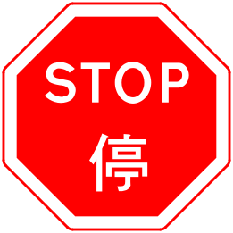
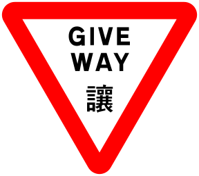
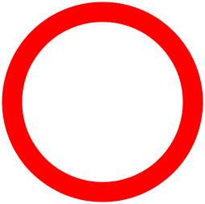
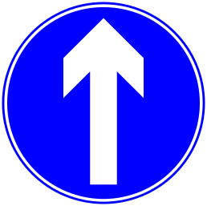
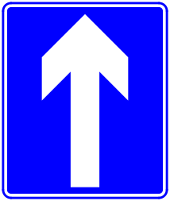
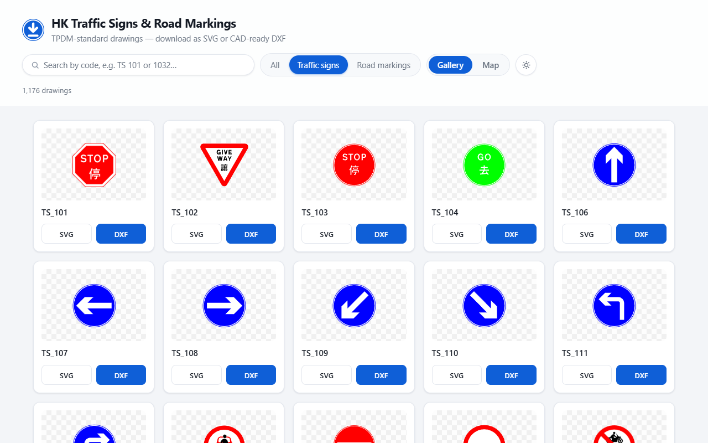
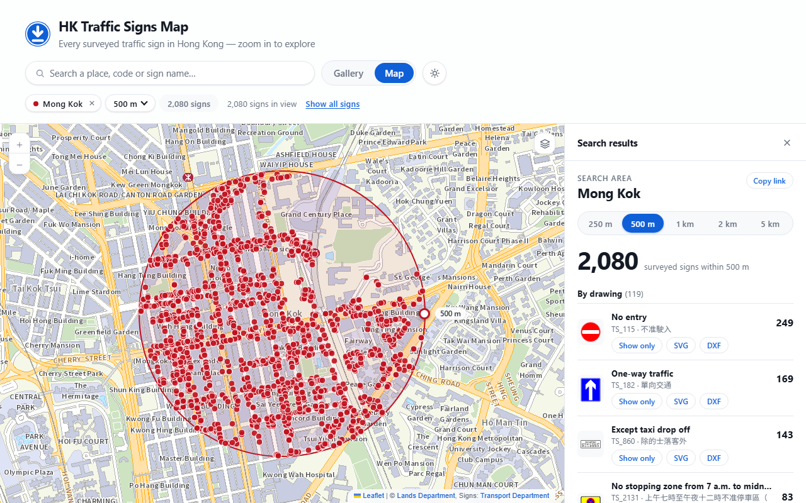
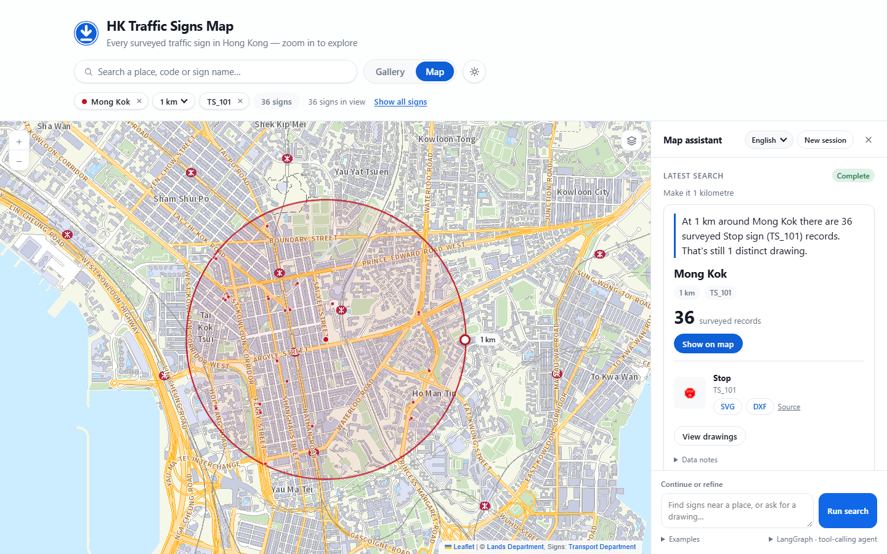

<div align="center">


# Hong Kong Traffic Signs and Road Markings

Browse every Hong Kong traffic sign and road marking drawing, download it as SVG or DXF,<br>
and see where about 157,000 surveyed signs stand on a map.

[](https://github.com/Lecberg/hk-tpdm-traffic-signs-markings/actions/workflows/test.yml)
[](https://lecberg.github.io/hk-tpdm-traffic-signs-markings/)


**[Open the gallery](https://lecberg.github.io/hk-tpdm-traffic-signs-markings/)** · **[Open the map](https://lecberg.github.io/hk-tpdm-traffic-signs-markings/map.html)** · [Run the assistant](#run-the-assistant-with-docker) · [Convert your own SVGs](#convert-your-own-files)

<br>

&nbsp;
&nbsp;
&nbsp;
&nbsp;
&nbsp;
&nbsp;


</div>

<br>

## What's included

| Tool | What it does | Needs |
| --- | --- | --- |
| 🗂️ **[Gallery](#gallery)** | Search 1,327 drawings (1,176 signs, 151 road markings) and download SVG or DXF files. | A web browser |
| 🗺️ **[Map](#map)** | Explore about 157,000 surveyed sign locations. Count signs around any place. | A web browser |
| 💬 **[Assistant](#run-the-assistant-with-docker)** | An agent that answers in your own words, such as “Compare Stop signs near Mong Kok and Tsim Sha Tsui”. | Docker and a model API key |
| 📐 **[svg2dxf](#convert-your-own-files)** | Turn your own SVG drawings into clean, fill-ready DXF files. | Python 3.9+ |

The gallery and map run on the public site with no installation or API key.

> [!TIP]
> **SVG** is an image format that stays sharp at any size. **DXF** is a drawing format that CAD software such as AutoCAD can open.

## Gallery

**[Open the gallery →](https://lecberg.github.io/hk-tpdm-traffic-signs-markings/)**

Search by code, such as `TS 101` or `1032`. Filter by traffic signs or road markings. Every card has **SVG** and **DXF** download buttons.

[](https://lecberg.github.io/hk-tpdm-traffic-signs-markings/)

## Map

**[Open the map →](https://lecberg.github.io/hk-tpdm-traffic-signs-markings/map.html)**

Zoom in to see each sign's face. Select a sign to see its code and downloads.

[](https://lecberg.github.io/hk-tpdm-traffic-signs-markings/map.html)

One search box handles three kinds of search:

| Type | Example | What you get |
| --- | --- | --- |
| A drawing code | `TS101`, `115` | Only those signs on the map |
| A place | “Mong Kok”, “Queen Mary Hospital” | A count of every surveyed sign nearby, a breakdown by drawing, and downloads |
| A sign name | “Stop”, “No entry” | Matching signs, for the 100 drawings with checked names |

- **Filters show as chips** above the map. Remove a chip to drop that filter.
- **Change the radius** from its chip, or drag the circle's edge.
- **Right-click the map** to search around any point.
- **Share a search** by copying the page link. The browser's Back button returns to the previous search.

## Run the assistant with Docker

The Docker version runs on your computer. It has the same gallery and map, and adds an assistant to the map's results panel.



<sub>Asked “Stop signs near Mong Kok within 500 metres”, then “Make it 1 kilometre”. It found 36 surveyed Stop signs and showed them on the map.</sub>

### Quick start

1. Install [Docker Desktop](https://www.docker.com/products/docker-desktop/) or another Docker engine with Compose.
2. Copy `.env.example` to `.env`, then add a model key (see below).
3. Start it:

   ```sh
   docker compose up --build -d
   ```

4. Open **http://localhost:8517**.

Stop it with `docker compose down`.

### Choose a model service

In `.env`, set `AI_PROVIDER` to one of `openai`, `deepseek`, `vercel` or `custom`, then add that provider's key and model:

```text
AI_PROVIDER=deepseek
DEEPSEEK_API_KEY=your-key
```

<details>
<summary><b>Use another OpenAI-compatible service</b></summary>

<br>

Choose `custom`, then set `CUSTOM_API_BASE_URL`, `CUSTOM_MODEL` and `CUSTOM_API_KEY`. Use the API base URL, not the full `/chat/completions` URL. The model must handle several tool calls in a row, because the assistant looks up signs, places and map data step by step. Small local models may struggle; `python scripts/eval_agent.py` checks a model with about 20 questions.

</details>

After you change `.env`, restart the backend and refresh the page:

```sh
docker compose up -d --force-recreate backend
```

> [!IMPORTANT]
> Keep `.env` private. Git already ignores it.

### Using the assistant

- **Ask** from the map's search box (choose **Ask the assistant**) or from the box at the bottom of the panel. On the gallery, type a question and choose **Ask on the map**.
- **Ask more than one thing.** “Compare Stop signs near Mong Kok and Tsim Sha Tsui” gives one result row per place. “Which sign is most common near Causeway Bay?” reads the counts for you.
- **Pick a place** from the list or from the numbered pins when a name matches several locations, such as “Tuen Mun” (the town or the district).
- **Refine** with follow-ups such as “Make it 1 kilometre”. Follow-ups build on what the map shows, including changes you made with the chips.

<details>
<summary><b>How the assistant works</b></summary>

<br>

The assistant is a tool-calling agent. The model chooses which lookups to run, reads each result, and decides when it has enough to answer. It can search the drawing catalog, find a place, count surveyed signs around a place, and ask you to pick when a place or drawing is ambiguous.

- **The model never handles coordinates.** A place lookup returns a short handle such as `p1`, and the map count only accepts handles from this session.
- **Result cards come only from the data.** Counts come from the surveyed records. Drawings and downloads come from the catalog.
- **The reply is checked.** Every number in the model's reply must appear in the lookup results. If one does not, the panel shows a standard summary instead.
- **Each question has limits:** at most 6 model calls, 10 lookups and 60 seconds. One question can therefore use several model calls; the limit of 5 questions a minute still applies.
- **How it ran** under each answer lists the lookups the agent made, not private model reasoning.
- Road-marking drawings can be searched by code, but surveyed road-marking locations are not available.
- The session lives in memory and expires after one hour without activity. Refreshing the page keeps it. Restarting the backend or choosing **New session** clears it.
- Requests, lookup results and your last few questions in the session go to your chosen model service. No other tracing service is enabled.

</details>

<details>
<summary><b>Run the assistant without Docker (for development)</b></summary>

<br>

Use Python 3.10+ (3.12 recommended). Set up `.env` as above, then run:

```sh
pip install -e ".[agent]"
python scripts/run_agent_prototype.py --port 8518
```

Open **http://localhost:8518/map.html?agent=1**. This server listens only on your computer and leaves the public site's API turned off. Use Docker for normal use.

</details>

## Convert your own files

The project includes `svg2dxf`, a small SVG-to-DXF converter. It needs Python 3.9+ and no Docker.

```sh
pip install -e .
svg2dxf sign.svg
```

This writes `sign.dxf` next to `sign.svg`.

## About the data

- **Drawings** follow Hong Kong traffic sign and road marking standards.
- **Map locations** come from the Transport Department's [Traffic Aids Drawings open data](https://data.gov.hk/en-data/dataset/hk-td-tis_16-traffic-aids-drawings-v2). Some surveyed signs have no matching drawing to download.
- **Place search** uses a saved list first. Other place names go to the Lands Department's location service, on both the public site and the Docker version.
- **Map tiles** need an internet connection.

## For developers

| Folder | Contents |
| --- | --- |
| `site/` | The public site: pages, drawings, map data. Pushes to `main` that change it deploy to GitHub Pages. |
| `src/svg2dxf/` | The converter, web app and assistant backend. |
| `scripts/` | Scripts that build the site, map data and search indexes. |
| `data/` | Place names and checked sign names. |
| `docker/`, `compose.yaml` | The Docker version. |
| `tests/` | Tests. |

Run the tests:

```sh
pip install -e ".[dev,agent]"
python -m pytest tests/ -q
```
